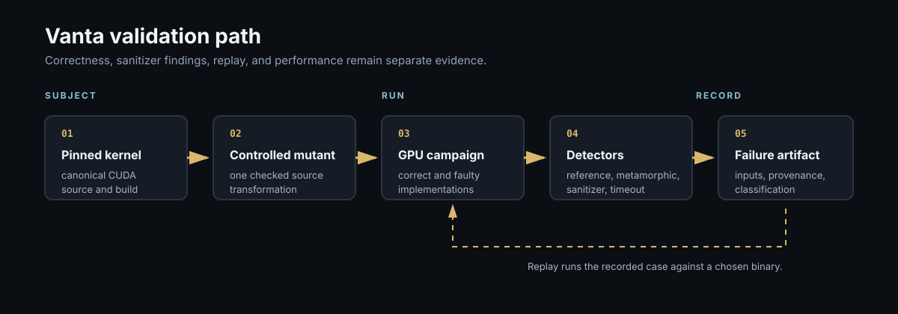

# Vanta

A CUDA validation lab built around replayable failures and explicit evidence boundaries.

Vanta compares GPU results with CPU references, checks metamorphic relations, runs Compute Sanitizer, serializes counterexamples, and replays them against a chosen binary.

## Proven on a Tesla T4

- Correct reduction, vector-add, and tiled-matrix-multiply campaigns
- Clean memcheck runs for the correct implementations
- Detection and replay of deliberate tail and tile defects
- 16 of 18 mutants killed in the first mutation campaign
- One equivalent mutant recorded as equivalent
- One instrumented deadlock recorded as infrastructure failure, not detection

Correctness, sanitizer output, replay classification, and performance remain separate evidence.
A clean sanitizer run does not prove numerical correctness or race freedom.

The v3 mutation matrix is a protocol until a GPU campaign produces committed evidence.

[Run on a GPU, inspect the campaigns, replay failures, and read the tolerance model](GUIDE.md).

[Development history and evidence index](docs/development-report.md).

## Build

See [GUIDE.md](GUIDE.md) for build presets and dependencies.

## Verification

Functional CI and performance evidence are separate. See [GUIDE.md](GUIDE.md) and `LAB_RULES.md` / `EVIDENCE.md` in `stra-ta/.github` for manifest provenance and the one-command suite (`./scripts/verify.sh` / `./scripts/confidence.sh` or `tools/verify.sh`).

## Limitations

CI is functional only. Performance evidence requires a committed manifest with machine metadata (commit, compiler, kernel, CPU, arch, build type, seed, argv) and a link from the claim to that artifact. See `stra-ta/.github` for lab-wide caveats.

